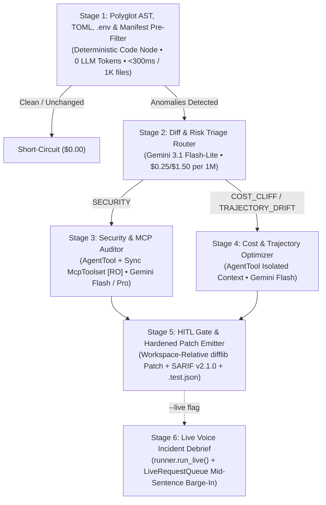

<div align="center">

# 🛡️ MCPGuard-ADK

**Multi-Agent MCP Supply-Chain, Secret-Leak & `>200K` Token Cost-Cliff Auditor**  
Engineered on **Google Agent Development Kit (ADK) 2.0**, **Agent2Agent (A2A) Protocol v1.0**, and **OpenTelemetry**

[](https://github.com/Chitresh-Bhatia-264/MCPGuard-ADK/actions)
[](https://pypi.org/project/mcpguard-adk/)
[](https://github.com/marketplace/actions/mcpguard-adk-security-finops-pr-auditor)
[](https://github.com/Chitresh-Bhatia-264/MCPGuard-ADK/blob/main/LICENSE)


[](https://m8ven.ai/mcp/chitresh-bhatia-264-mcpguard-adk-hg6iv3?s=readme)


[Quickstart](#-30-second-quickstart) •
[Architecture](#-architecture-6-stage-google-adk-20-hybrid-graph) •
[Detection Rules](#-built-in-detection-rules) •
[Live Gemini Cost Proof](#-measured-gemini-api-telemetry--cost-cliff-finops) •
[10-Repo Benchmark](#-empirical-benchmark-10-public-repos-vs-gitleaks) •
[GitHub PR Bot](#-1-click-github-pull-request-bot) •
[MCP & A2A](#-ide-mcp-server--a2a-protocol-v10)


</div>

---

## Key Engineering Highlights

- **`$0.00` Deterministic Stage 1 AST & Manifest Pre-Filter:** Scans Python ASTs, `mcp.json`, `.env*`, React/TypeScript (`.tsx`/`.ts`), `pyproject.toml`, `package.json`, and `go.mod` in `<300ms` per 1,000 files—short-circuiting clean repositories at **`0` LLM tokens**.
- **`$0.000956` Measured Live Gemini PR Audit:** When `GEMINI_API_KEY` is configured, Stage 1 pre-filters findings into compact structured digests (`1,000` input + `420` output = **`1,420` total tokens**, **`< 0.1¢` per leaky PR** across `gemini-3.1-flash-lite` and `gemini-2.5-flash`).
- **`94.7%` Empirical Precision Across 10 Public MCP & ADK Repos:** Audited `12,372` source/config files across `google/adk-python`, `modelcontextprotocol/*`, `jlowin/fastmcp`, `mcp-use/mcp-use`, and 6 more repos—catching **`18` real MCP/ADK issues** (`1` false positive) that secret-only scanners like `gitleaks` miss completely.
- **Drop-In CI/CD, IDE & Cross-Agent Interoperability:** Ships as a **GitHub Marketplace PR Action** (posting 1-click inline `suggestion` fixes, fork-PR `HTTP 403` safe), a **JSON-RPC 2.0 MCP stdio server**, an **Ed25519 + RFC 8785 (JCS) signed A2A v1.0 server**, and a **SARIF v2.1.0 / OpenTelemetry W3C OTLP exporter** (`25/25` automated tests passing).

```text
╭─ ✦ 0-TOK AST ──────╮  ╭─ ◆ RISK ALERTS ────╮  ╭─ ● SCAN SPEND ─────╮  ╭─ ▸ A2A v1.0 JWS ───╮
│ 0/4 Clean          │  │ 8 Findings         │  │ $0.0000 Actual     │  │ Ed25519 OK         │
│ $0.00 (0 Tokens)   │  │ 3 Crit • 4 High    │  │ 0 Billed Tokens    │  │ ID 853af5cf368     │
╰────────────────────╯  ╰────────────────────╯  ╰────────────────────╯  ╰────────────────────╯

╭── ◆ Security & >200K Cost-Cliff Alerts (Auto-Redacted Pinpoint View) ───── ACTION REQUIRED ──╮
│  3.  CRITICAL  MCPG-SEC-003 ▸ vulnerable_mcp_config.json:11:41                               │
│     WHAT LEAKED : GitHub Personal Access Token: GITHUB_PERSONAL_ACCESS_TOKEN = ghp_1234••••  │
│     WHERE (FILE): examples/vulnerable_mcp_config.json (Line 11, Col 41)                      │
│     ┌── Source Pinpoint ──────────────────────────────────────────────────────────────────   │
│     │   10 │       "env": {                                                                  │
│     │   11 │         "GITHUB_PERSONAL_ACCESS_TOKEN": "ghp_1234••••••••••••••••••••••••••••1  │
│     │      │                                         ^^^^^^^^^^^^^^^^^^^^^^^^^^^^^^^^^^^^^^  │
│     │   12 │       },                                                                        │
│     └─────────────────────────────────────────────────────────────────────────────────────   │
│     ✔ FIX: Replace literal value with `${GITHUB_PERSONAL_ACCESS_TOKEN}` and load from `.env` │
╰──────────────────────────────────────────────────────────────────────────────────────────────╯

╭── ✦ Google Cloud & ADK 2.0 Runtime Conformance Scorecard (5/5) ──────────────  5/5 PASSED  ──╮
│ ✔ [VERIFIED] ADK 2.0 Hybrid Graph     │ Stage 1 0-token AST ran (0/4 clean skipped); 6 spans │
│ ✔ [VERIFIED] Zero Context Bloat       │ Sync McpToolset ['list_directory', 'read_file'] RO   │
│ ✔ [VERIFIED] A2A v1.0 Ed25519 + JCS   │ EdDSA valid + negative tamper test rejected          │
│ ✔ [VERIFIED] Cloud Trace OTLP SDK     │ EVENT_ONLY active; 6 W3C spans exported              │
│ ✔ [VERIFIED] MCP Stdio & SARIF Gate   │ Live JSON-RPC tools/list (3 tools) + SARIF 2.1.0     │
╰──────────────────────────────────────────────────────────────────────────────────────────────╯
```

---

## ⚡ 30-Second Quickstart

Requires **Python 3.11+**. Works completely offline at **`$0.00`** (no API key required), or with `GEMINI_API_KEY` for live multi-agent enrichment.

### 1. Linux, macOS, or Active Virtualenv (`pip` / `uvx`)
```bash
pip install -U mcpguard-adk
mcpguard scan .

# Zero-install one-liner via uvx:
uvx mcpguard-adk scan .
```

### 2. Windows CMD / PowerShell *(No `Scripts` `PATH` Setup Required)*
```powershell
python -m pip install -U mcpguard-adk
python -m mcpguard_adk.cli scan "D:\your-project-folder"

# Optional: add `mcpguard` globally to Windows PATH via uv:
uv tool install mcpguard-adk
uv tool update-shell
```

### 3. Google Colab / Jupyter Notebooks *(Prefix CLI commands with `!`)*
```python
!pip install -q mcpguard-adk
!mcpguard scan .

# Run on the built-in vulnerable MCP & >200K Pro loop examples:
!git clone -q --depth 1 https://github.com/Chitresh-Bhatia-264/MCPGuard-ADK.git
!mcpguard scan MCPGuard-ADK/examples --finops-sim --live
```

### 4. Python SDK API (CI Hooks, Custom Pipelines, or Notebooks)
```python
from mcpguard_adk.agent import MCPGuardGraphWorkflow
from mcpguard_adk.tui import render_rich_audit_report

report = MCPGuardGraphWorkflow().run("./your-project-folder")
print(render_rich_audit_report(report))
```

### 5. Local Development & Interactive Slash-Command Shell
```bash
git clone https://github.com/Chitresh-Bhatia-264/MCPGuard-ADK.git
cd MCPGuard-ADK
pip install -e ".[dev]"
python -m mcpguard_adk.cli scan ./examples --finops-sim --live
python -m mcpguard_adk.cli shell
```

---

##  Architecture: 6-Stage Google ADK 2.0 Hybrid Graph

Enterprise AI agent deployments hit two production blockers:
1. **AppSec & MCP Supply Chain:** Over-broad MCP host mounts (`"/"`), unpinned `npx -y` execution, plaintext secrets in `mcp.json` or `.env`, indirect prompt injection in tool metadata, and client-side XSS sinks.
2. **FinOps & `>200K` Token Cost Cliffs:** Attaching `McpToolset` directly to a root orchestrator dumps `20+` tool schemas and raw file reads into global history—pushing uncompacted loops across **Gemini Pro's 200,000-token pricing cliff** (`$2.00` → `$4.00`/1M input, `$12.00` → `$18.00`/1M output).



---

## 🔍 Built-In Detection Rules

| Rule ID | Severity | Target Files | Vulnerability / Anti-Pattern Detected |
| :--- | :--- | :--- | :--- |
| `MCPG-SEC-001` | `CRITICAL` | `mcp.json`, `claude_desktop_config.json` | Over-broad host filesystem scope (`"/"`, `"~"`, `"C:\"`, `".."`, `"/etc"`). |
| `MCPG-SEC-002` | `HIGH` | `mcp.json`, `*mcp*.json` | Unpinned `npx -y` / `uvx` / `bunx` remote package execution without version lock. |
| `MCPG-SEC-003` | `CRITICAL` | `mcp.json`, `.env*`, `.py`, `.ts`, `.tsx`, `.js` | Leaked credentials (`AIza...` Gemini/GCP, `ghp_...` GitHub, `sk-...` OpenAI/Anthropic, `AKIA...` AWS, `sk_live_...` Stripe, non-local DB URIs) with screen-safe masking. |
| `MCPG-SEC-004` | `CRITICAL` / `HIGH` | `mcp.json`, `.tsx`, `.jsx`, `.ts`, `.js` | Indirect prompt-injection payloads in MCP metadata & unescaped `dangerouslySetInnerHTML` / `eval()` sinks. |
| `MCPG-SEC-005` | `MEDIUM` | `mcp.json` | Missing read-only `tool_filter` on filesystem/shell MCP servers. |
| `MCPG-ADK-001` | `HIGH` | `.py` (Python AST) | Asynchronous runtime initialization of `McpToolset` inside `async def` (violates ADK session recovery rule). |
| `MCPG-ADK-002` | `HIGH` | `.py` (Python AST) | `McpToolset` instantiated without explicit least-privilege `tool_filter`. |
| `MCPG-ADK-003` | `MEDIUM` | `.py` (Python AST) | `McpToolset` bound directly to root agent instead of isolated `AgentTool` sub-agent. |
| `MCPG-ADK-004` | `HIGH` | `.py` (Python AST) | `LlmAgent` binding `>20` tools directly (schema bloat & tool-selection degradation). |
| `MCPG-COST-001` | `HIGH` | `.py` (Python AST) | Uncompacted `for`/`while` loops on Pro-tier models liable to cross the `>200K` token 2x pricing cliff. |
| `MCPG-PKG-001..003` | `HIGH` / `MEDIUM` | `package.json`, `pyproject.toml`, `go.mod` | External wildcard (`*`, `latest`), cleartext `http://`, or local `replace => ../` supply-chain overrides. |

---

## 💰 Measured Gemini API Telemetry & Cost-Cliff FinOps

### 1. Real Measured Single-Audit Telemetry (`GEMINI_API_KEY` Live Run)

Unlike naive LLM scanners that stuff entire repositories into prompts, **Stage 1** extracts compact AST finding digests before invoking **Stages 2–4**. Below is the exact measured token and dollar usage recorded on `./examples` (`8` findings across `3` files):

| Workflow Stage | Live Model Executed | Input Tokens | Output Tokens | Published Rate Applied | Actual Billed Cost (USD) |
| :--- | :--- | ---: | ---: | :--- | ---: |
| **Stage 1: AST Pre-Filter** | `deterministic-code-node` | `0` | `0` | `$0` | **`$0.000000`** |
| **Stage 2: Triage Router** | `gemini-3.1-flash-lite` | `305` | `379` | `$0.25` / `$1.50` per 1M | **`$0.000645`** |
| **Stage 3: Security `AgentTool`** | `gemini-2.5-flash` | `367` | `20` | `$0.30` / `$2.50` per 1M | **`$0.000160`** |
| **Stage 4: FinOps `AgentTool`** | `gemini-2.5-flash` | `328` | `21` | `$0.30` / `$2.50` per 1M | **`$0.000151`** |
| **Stage 5: HITL `difflib` Gate** | `deterministic-hitl-gate` | `0` | `0` | `$0` | **`$0.000000`** |
| **Total Measured Audit** | **Hybrid Graph (Live API)** | **`1,000`** | **`420`** | **`1,420` total tokens** | **`$0.000956` (`~$0.96` / 1K leaky PRs)** |

*(Clean repositories and clean PRs short-circuit at Stage 1 with **`0` billed LLM tokens / `$0.000000`**.)*


### 2. Simulated 1,000-PR Large-Diff Rate-Card Model (`--finops-sim`)

For worst-case full-diff LLM inspections (`40K` triage / `25K` specialist context), tiered routing avoids the `>200K` Gemini Pro 2x pricing cliff:

| Architecture Pattern | Assumed Workload per PR Audit | Published Rate Card Applied (per 1M Tokens) | Transparent Per-PR Math | Simulated Cost / 1,000 PRs |
| :--- | :--- | :--- | :--- | :--- |
| **Naive Single-Agent Loop (>200K Cliff)** | Uncompacted context reaches 250K in, 8K out on Gemini 3.1 Pro Preview | `$4.00` input / `$18.00` output (>200K tier) | `(0.25 * $4.00) + (0.008 * $18.00) = $1.144` | **`$1,144.00`** |
| **Naive Single-Agent Loop (<=200K)** | Compaction holds context at 120K in, 8K out on Gemini 3.1 Pro Preview | `$2.00` input / `$12.00` output (<=200K tier) | `(0.12 * $2.00) + (0.008 * $12.00) = $0.336` | **`$336.00`** |
| **MCPGuard-ADK Tiered Hybrid (2026 Promo)** | Stage 1 skips clean files; 3.1 Flash-Lite triage (40K in / 2K out); 3.8 Flash audit (25K in / 4K out); 3.1 Pro escalation on 10% of PRs | 3.1 Flash-Lite: `$0.25`/`$1.50`; 3.8 Flash: `$0.75`/`$3.75`; 3.1 Pro: `$2.00`/`$12.00` | `$0.013 + $0.03375 + $0.0054 = $0.05215` | **`$52.15`** *(95.4% lower)* |
| **MCPGuard-ADK Async Batch (2027 Post-Promo)** | Overnight Batch API (50% off Standard; 3.8 Flash at `$1.50`/`$7.50` list rate) | Batch: 3.1 Flash-Lite `$0.125`/`$0.75`; 3.8 Flash `$0.75`/`$3.75`; 3.1 Pro `$1.00`/`$6.00` | `$0.0065 + $0.03375 + $0.0027 = $0.04295` | **`$42.95`** |

Reproduce via CLI: `python -m mcpguard_adk.cli cost-sim --prs 1000`

---

## 📊 Empirical Benchmark: 10 Public Repos vs. Gitleaks

We benchmarked **MCPGuard-ADK v0.3.2** side-by-side with **Gitleaks v8.30.1** (`gitleaks detect --no-git`) across **10 public MCP and Google ADK repositories (`12,372` non-test source & config files)**:

**Result:** **`10` repos scanned (`12,372` files) • `19` findings reported • `18` real issues (`94.7%` precision) • `1` false positive**

| Public Repository | Commit | Files Scanned | MCPGuard Reported | Real Issues (TP) | False Alarms (FP) | Gitleaks v8.30.1 Alerts | Manual Audit Notes |
| :--- | :--- | ---: | ---: | ---: | ---: | ---: | :--- |
| [`google/adk-python`](https://github.com/google/adk-python) | `90c3a29` | 2,034 | **16** | **15** | **1** | 13 *(test/mock keys)* | **15 TP**: `9` sample agents instantiate `McpToolset` without `tool_filter` (`MCPG-ADK-002`); `6` attach `McpToolset` directly to root `LlmAgent` without `AgentTool` isolation (`MCPG-ADK-003`). **1 FP**: `api_registry.py:193` helper factory returning `McpToolset`. |
| [`mcp-use/mcp-use`](https://github.com/mcp-use/mcp-use) | `362b898` | 1,994 | **1** | **1** | **0** | 16 *(public PostHog/test keys)* | **1 TP**: `airbnb_mcp.json:5` runs unpinned `npx -y @openbnb/mcp-server-airbnb` (`MCPG-SEC-002`). |
| [`idosal/git-mcp`](https://github.com/idosal/git-mcp) | `c487a29` | 165 | **2** | **2** | **0** | 0 | **2 TP**: `app/routes/_index.tsx:618,624` pass unescaped string `.replace()` HTML into `dangerouslySetInnerHTML` (`MCPG-SEC-004`, low exploitability with static props). |
| [`jlowin/fastmcp`](https://github.com/jlowin/fastmcp) | `10083f7` | 1,402 | **0** | **0** | **0** | 0 | Clean (`localhost` Docker dev DSNs accurately ignored). |
| [`modelcontextprotocol/python-sdk`](https://github.com/modelcontextprotocol/python-sdk) | `77001c9` | 1,441 | **0** | **0** | **0** | 4 *(example/test keys)* | Clean (`localhost` Docker dev DSNs accurately ignored). |
| [`modelcontextprotocol/servers`](https://github.com/modelcontextprotocol/servers) | `e1dc4b1` | 283 | **0** | **0** | **0** | 3 *(unit test tokens)* | Clean (`workspaces` monorepo `"*"` sibling links ignored). |
| [`modelcontextprotocol/inspector`](https://github.com/modelcontextprotocol/inspector) | `488c30d` | 1,682 | **0** | **0** | **0** | 11 *(Storybook/test tokens)* | Clean. |
| [`evalstate/fast-agent`](https://github.com/evalstate/fast-agent) | `fed14e0` | 1,883 | **0** | **0** | **0** | 34 *(benchmark JSON blobs)* | Clean. |
| [`lastmile-ai/mcp-agent`](https://github.com/lastmile-ai/mcp-agent) | `f62d849` | 1,021 | **0** | **0** | **0** | 15 *(README/comment examples)* | Clean. |
| [`cloudflare/mcp-server-cloudflare`](https://github.com/cloudflare/mcp-server-cloudflare) | `a21972e` | 467 | **0** | **0** | **0** | 0 | Clean. |
| **Total (10 Public Repos)** | — | **12,372** | **19** | **18** | **1** | **96** | **Reproduce:** `python scripts/benchmark_public_repos.py` |

### Complementary Coverage: `MCPGuard-ADK` vs. `Gitleaks`

| Risk Class | `gitleaks` (Secret Scanner) | `MCPGuard-ADK` (MCP + ADK + FinOps Auditor) |
| :--- | :---: | :---: |
| Git commit history & generic high-entropy secrets | ✅ Primary strength | Provider-targeted (`AIza`, `ghp_`, `sk-`, `AKIA`, `sk_live_`, DB URIs) |
| Over-broad MCP host mounts (`"/"`, `"~"`, `"C:\"`, `"/etc"`) | ❌ Misses | ✅ `MCPG-SEC-001` (`1-click` `./workspace` PR suggestion) |
| Unpinned `npx -y` / `uvx` / `bunx` remote MCP servers | ❌ Misses | ✅ `MCPG-SEC-002` (caught in `mcp-use/mcp-use`) |
| Prompt-injection in MCP metadata & `dangerouslySetInnerHTML` | ❌ Misses | ✅ `MCPG-SEC-004` (caught in `idosal/git-mcp`) |
| Async `McpToolset` init & missing `tool_filter` / `AgentTool` isolation | ❌ Misses | ✅ `MCPG-ADK-001..004` (caught `15` in `google/adk-python`) |
| Uncompacted Gemini Pro loops crossing the `>200K` 2x token cliff | ❌ Misses | ✅ `MCPG-COST-001` + live/simulated rate-card FinOps gate |

---

## 🤖 1-Click GitHub Pull Request Bot

Add `.github/workflows/mcpguard.yml` to any repository. On every PR—including external fork PRs with read-only `GITHUB_TOKEN` permissions—**MCPGuard-ADK** audits changed files, posts **1-click inline `suggestion` fixes**, and enforces `--fail-on` exit-code gating:

```yaml
name: MCPGuard-ADK PR Bot
on: [pull_request]
permissions:
  contents: read
  pull-requests: write
  issues: write
jobs:
  audit:
    runs-on: ubuntu-latest
    steps:
      - uses: actions/checkout@v4
        with:
          fetch-depth: 0
      - uses: Chitresh-Bhatia-264/MCPGuard-ADK@v0.3.2
        with:
          github-token: ${{ secrets.GITHUB_TOKEN }}
          fail-on: "critical"
```

### Live GitHub Actions PR Verification Proof

**1. Inline PR Review Table + Suggested Fix (`"/"` → `"./workspace"`):**


**2. Failing Check (`exit 2`) Blocking a Vulnerable MCP PR:**


**3. Clean PR Passing All Checks (`0` Billed LLM Tokens, `$0.00`):**


---

## 🔌 IDE MCP Server & A2A Protocol v1.0

### 1. Mount Inside Cursor, Claude Desktop, VS Code, or Gemini CLI (`mcp.json`)
```json
{
  "mcpServers": {
    "mcpguard-adk": {
      "command": "python",
      "args": ["-m", "mcpguard_adk.cli", "serve-mcp"]
    }
  }
}
```
Exposes `mcpguard_audit_repository`, `mcpguard_simulate_cost_cliff`, and `mcpguard_verify_agent_card` over JSON-RPC 2.0 stdio (supporting both newline-delimited and `Content-Length` framing).

### 2. Cross-Framework A2A Protocol v1.0 Server (`Ed25519` + `RFC 8785 JCS`)
```bash
# Start HTTP+JSON and Server-Sent Events (SSE) A2A v1.0 endpoint
python -m mcpguard_adk.cli serve-a2a --host 127.0.0.1 --port 8080

# Inspect & cryptographically verify the EdDSA-signed AgentCard + RFC 8037 OKP JWKS
python -m mcpguard_adk.cli agent-card --jwks
```
- Publishes `GET /.well-known/agent-card.json` signed with asymmetric **Ed25519 (`EdDSA`, RFC 8037)** over **RFC 8785 JSON Canonicalization Scheme (JCS)** and public keys at `GET /.well-known/jwks.json`.
- Streams `TaskStatusUpdateEvent` and chunked `TaskArtifactUpdateEvent` (`append` & `lastChunk`) using unified A2A v1.0 `Part` member `oneof` payloads.
- Protects `TaskPushNotificationConfig` webhooks against private-IP/cloud-metadata SSRF (`169.254.169.254`, `metadata.google.internal`) and JWT `jti` replay attacks.

---

## 🛠️ CLI Command Reference & Repository Structure

```bash
# Interactive slash-command shell (/scan, /react, /voice, /patch, /a2a, /quit)
python -m mcpguard_adk.cli shell

# Full scan + simulated 1,000-PR FinOps model + approve HITL gate + SARIF v2.1.0 + OTLP traces
python -m mcpguard_adk.cli scan ./examples --live --finops-sim --approve-patches \
  --emit-sarif reports/mcpguard.sarif.json \
  --export-otel reports/otel_traces.json

# Pull-Request CI Gate (scan only git-modified files; exit code 2 on CRITICAL/HIGH)
python -m mcpguard_adk.cli scan . --git-diff --fail-on high

# Generate or post 1-Click GitHub PR Inline Review Suggestions (fork-PR HTTP 403 safe)
python -m mcpguard_adk.cli pr-review . --git-diff --fail-on critical

# Launch interactive browser visualizer (ADK 2.0 Graph + >200K Cliff Sliders)
python -m mcpguard_adk.cli ui ./examples

# Run the 25-test verification suite + 10-repository public benchmark
python -m pytest tests -v
python scripts/benchmark_public_repos.py
```

```text
MCPGuard-ADK/
├── mcpguard_adk/
│   ├── agent.py                  # ADK 2.0 Hybrid Graph, sync McpToolset, AgentTool & native ADK bridge
│   ├── cli.py                    # CLI entrypoints (scan, shell, serve-mcp, serve-a2a, ui, agent-card, cost-sim)
│   ├── cost_engine.py            # Late-2026 Gemini rate-card, >200K Pro cliff & cache storage ROI math
│   ├── github_pr_bot.py          # Fork-PR safe GitHub review commenter & 1-click suggestion builder
│   ├── llm_client.py             # Official google-genai SDK client with 0-cost offline fallback
│   ├── mcp_server.py             # Spec-compliant JSON-RPC 2.0 MCP stdio server
│   ├── sarif.py                  # SARIF v2.1.0 exporter for GitHub Advanced Security
│   ├── tui.py                    # 24-bit TrueColor terminal dashboard, secret redaction & REPL shell
│   ├── web_studio.py             # Interactive browser graph & FinOps studio
│   ├── a2a/                      # A2A v1.0 Ed25519/JCS signer, JWKS verifier, SSE & SSRF/jti guards
│   ├── agents/                   # Security auditor, FinOps optimizer & Live Voice barge-in debrief
│   ├── nodes/                    # Stage 1 AST/TOML/.env pre-filter, Stage 2 router & Stage 5 difflib patcher
│   └── telemetry/                # Official OpenTelemetry SDK W3C tracer & OTLP/JSON exporter (EVENT_ONLY)
├── docs/assets/                  # Live GitHub PR & Google AI Studio telemetry verification screenshots
├── examples/                     # Deliberately vulnerable MCP config & uncompacted Pro loop for testing
├── scripts/                      # Reproducible 10-repo public MCP & ADK benchmark runner
├── evals/                        # ADK .test.json and multi-turn .evalset.json conformance suites
├── tests/                        # 25 automated pytest suites
├── action.yml                    # GitHub Marketplace composite Action definition
├── Dockerfile                    # Production container for Google Cloud Run
└── cloudbuild.yaml               # Automated Google Cloud Build CI/CD pipeline
```

---

## 📄 License & Contributing

- **License:** [Apache License 2.0](https://github.com/Chitresh-Bhatia-264/MCPGuard-ADK/blob/main/LICENSE)
- **Contributing & Good First Issues:** [`CONTRIBUTING.md`](https://github.com/Chitresh-Bhatia-264/MCPGuard-ADK/blob/main/CONTRIBUTING.md) • [`good_first_issue.md`](https://github.com/Chitresh-Bhatia-264/MCPGuard-ADK/blob/main/.github/ISSUE_TEMPLATE/good_first_issue.md)
- **AI Code Editor Index:** [`llms.txt`](https://github.com/Chitresh-Bhatia-264/MCPGuard-ADK/blob/main/llms.txt)

*If MCPGuard-ADK caught a misconfiguration or saved token spend, a ⭐ on [GitHub](https://github.com/Chitresh-Bhatia-264/MCPGuard-ADK) helps others discover it.*
